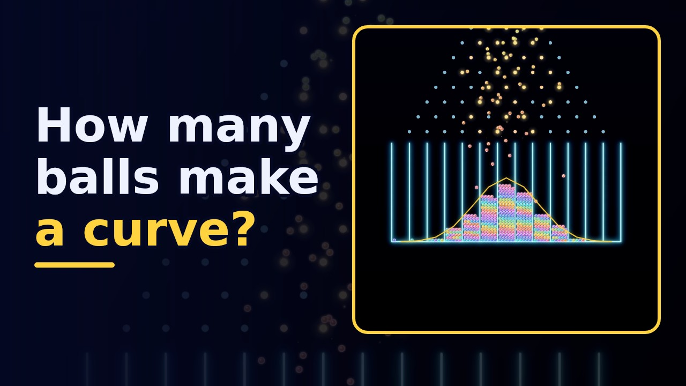
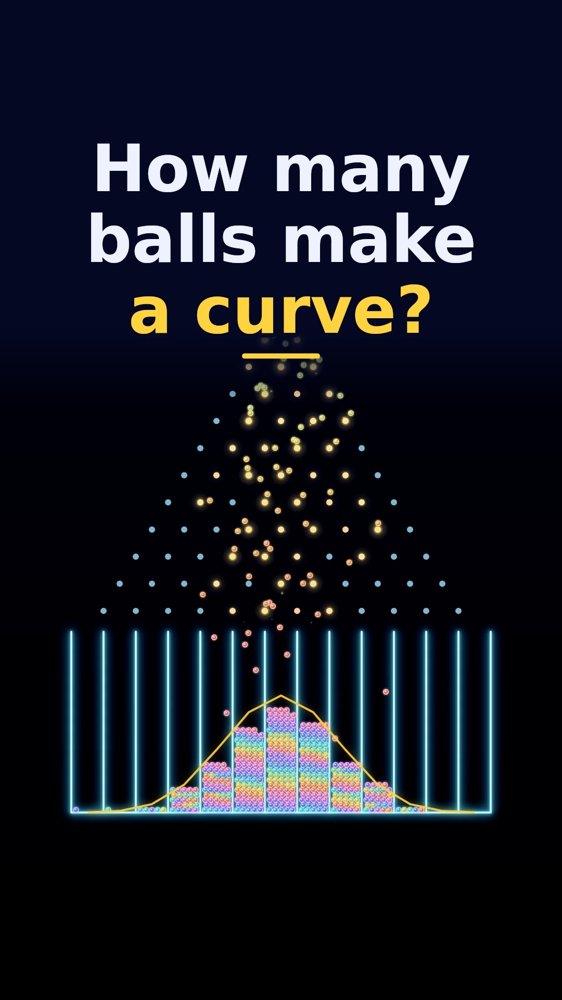
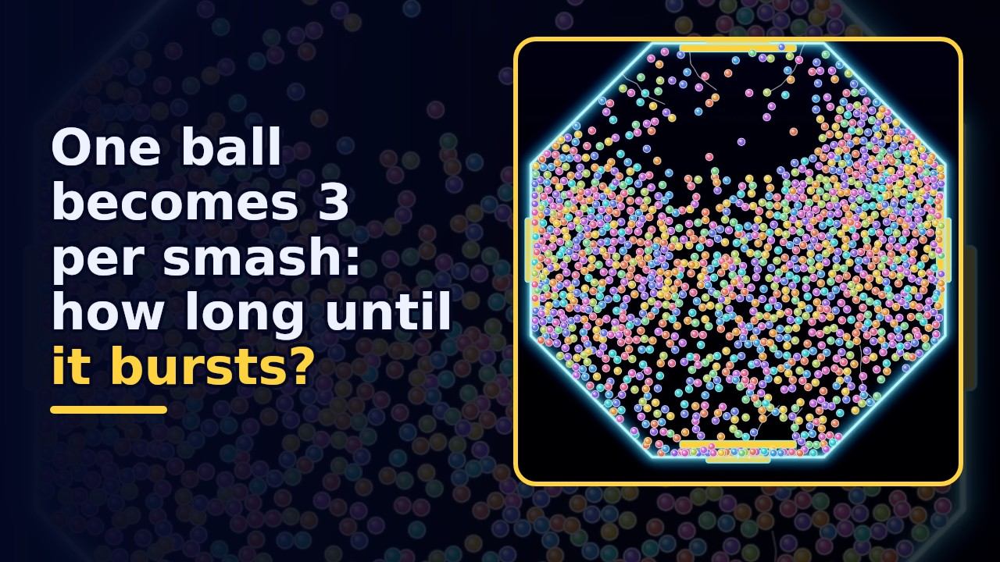
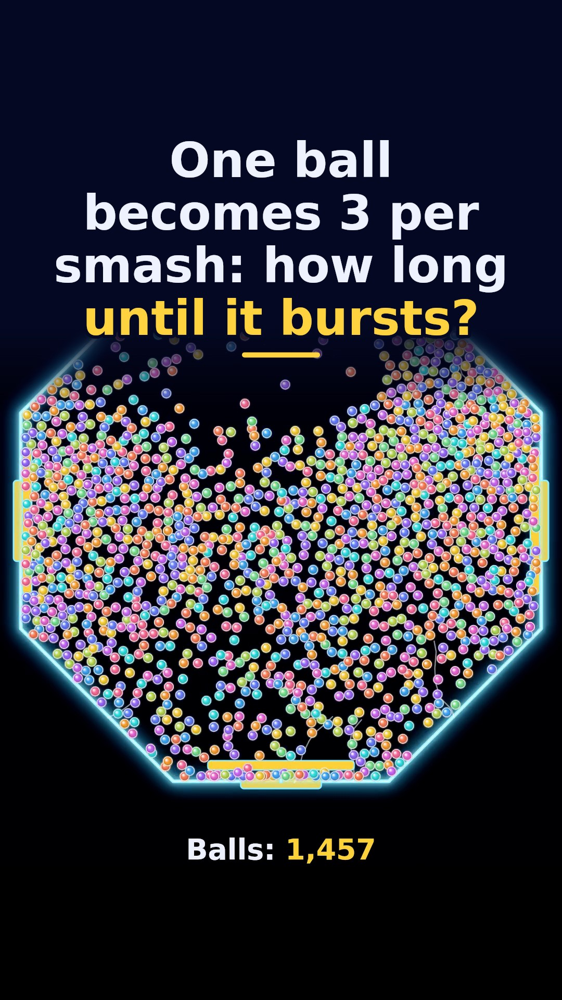
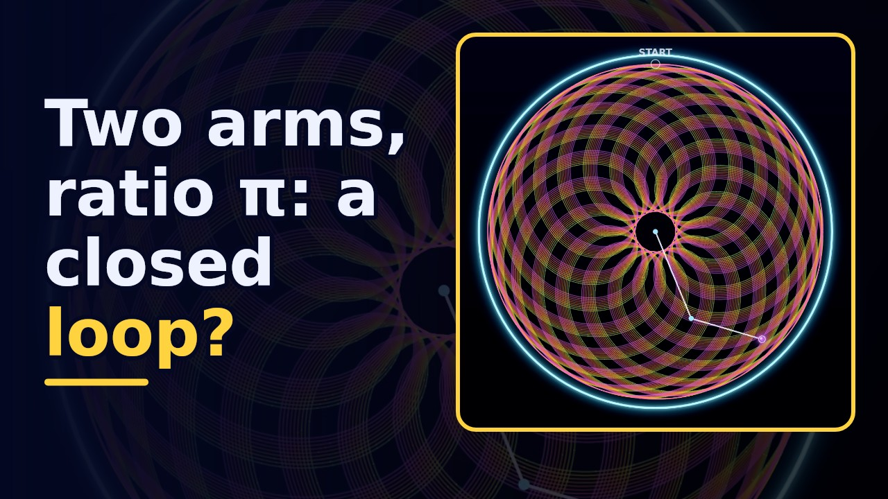
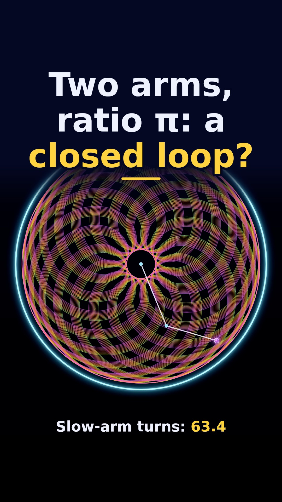

# Three real examples

Generated from real renders in `output/` by the studio's own code (no hand editing). Each picture was made by the automatic best-frame pick. Regenerate with the Videos page: open a video, **Pick the best frame automatically**.

## galton-board

Scene `galton-board`, rule/mode `-`, seed 7, frame at 25 s of 30.0 s.

 

**Title (default pick, 48/100):** Will chance alone build a bell curve in 12 rows?

**Five titles**

- *Direct question* (37): Can pure chance draw a bell curve? 🔔
- *What is at stake* (48): Will chance alone build a bell curve in 12 rows?
- *Starts with a number* (35): 520 random balls vs. one bell curve
- *Curious statement* (49): Chaos on every peg, a bell curve at the bottom 🔔
- *How / why explainer* (51): Why does chance draw a bell curve? The Galton board

**Description (477/5000 bytes)**

> Will chance alone build a bell curve in 12 rows? A Galton board turns pure chance into a bell curve.
> 
> Every ball bounces left or right at random on each peg, and the piles at the bottom grow into a bell curve. Each bounce is random, yet the piles follow the shape that probability predicts.
> 
> Every frame comes from a physics simulation, not from hand-made animation.
> 
> Which part surprised you most? Tell me in the comments.
> If this was fun to watch, subscribe for the next one.

**Tags (221/500 characters):** bell curve, galton board, normal distribution, probability, statistics, randomness, central limit theorem, binomial distribution, probability simulation, physics simulation, math visualization, science, classic neon

**Hashtags:** #Shorts #probability #math

**Quality check:** all good

## hammer-smash-split

Scene `hammer-smash`, rule/mode `split`, seed 7, frame at 45.83 s of 55.0 s.

 

**Title (default pick, 58/100):** One ball becomes 3 per smash: how long until it bursts? 🔨

**Five titles**

- *Direct question* (44): Can the octagon hold this chain reaction? 🔨
- *What is at stake* (54): Every smash turns one ball into 3. When does it burst?
- *Starts with a number* (58): One ball becomes 3 per smash: how long until it bursts? 🔨
- *Curious statement* (46): Exponential growth, one hammer swing at a time
- *How / why explainer* (56): Why smashing balls fills the octagon: exponential growth

**Description (522/5000 bytes)**

> One ball becomes 3 per smash: how long until it bursts? A hammer chain reaction where every crushed ball splits into 3 balls.
> 
> Hammers slam out of the walls and every ball they crush splits into 3 balls. The number of balls explodes until the octagon is full and bursts.
> 
> Everything on screen is a real 2D simulation with exact, repeatable maths: same settings, same result.
> 
> What is your guess? Leave it in the comments before you watch the ending.
> More physics and math simulations are on the way. Subscribe to see them.

**Tags (212/500 characters):** chain reaction, exponential growth, hammer smash, bouncing balls, satisfying simulation, oddly satisfying, ball physics, multiplying balls, physics simulation, math visualization, science, classic neon

**Hashtags:** #Shorts #satisfying #physics

**Quality check:** all good

## sync-lines-close

Scene `sync-lines`, rule/mode `close`, seed 7, frame at 36.36 s of 45.0 s.

 

**Title (default pick, 33/100):** Two arms, ratio π: a closed loop?

**Five titles**

- *Direct question* (40): Does the line ever close into a loop? ♾️
- *What is at stake* (55): Will the pen ever find its start and close the loop? ♾️
- *Starts with a number* (33): Two arms, ratio π: a closed loop?
- *Curious statement* (56): A line that closes only for the right ratio: closed loop
- *How / why explainer* (48): Why only some ratios close the loop: two-arm pen

**Description (376/5000 bytes)**

> Two arms, ratio π: a closed loop? A two-arm pen draws a line, and the question is whether it ever makes a closed loop.
> 
> Two arms turn at different speeds and a pen at the end draws a line.
> The speed ratio decides whether the pen ever returns to its start and closes the loop.
> 
> Want to see another setup? Suggest one in the comments. Subscribe for a new simulation every week.

**Tags (205/500 characters):** closed loop, speed ratio, irrational numbers, rational numbers, two arm pen, spirograph, patterns, satisfying simulation, math visualization, sync & close, physics simulation, science, classic neon

**Hashtags:** #Shorts #math #satisfying

**Quality check:** all good
