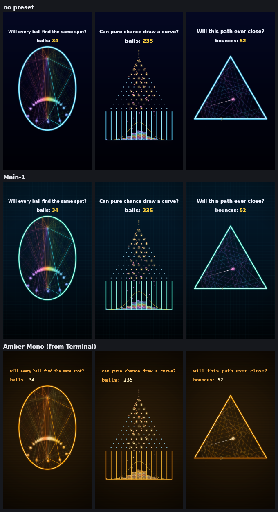

# Style — sidik jari referensi dan 5 style sendiri

## 1. Sidik jari referensi ("zona yang dihindari")

Disimpulkan dari `docs/analysis.md` §3–§5 dan contact sheet 18 video (frame pada t = 20 s).

| Sumbu | Gaya bersama ke-18 video referensi |
|---|---|
| Palet | Navy→hitam (#030619 → #000005), dinding neon **cyan** #9CF3FF, bola **pelangi berurutan**, aksen **emas** #FFD23F untuk angka dan jawaban |
| Latar | Gradien polos tanpa tekstur, vignette sangat halus |
| Bentuk & garis | Garis neon tipis dengan bloom; bola bulat mengilap dengan cincin putih dan glow; ekor komet; jejak string-art aditif tipis; cincin fokus bulat |
| Tipografi | DejaVu Sans Bold, rata tengah, judul pertanyaan ±58 px di sepertiga atas; counter `label: nilai` dengan nilai emas; handle abu-abu kecil |
| Gerak & easing | Kecepatan fisik konstan, tanpa easing presentasi; tanpa kamera atau transisi; angka counter langsung melompat |
| Tingkat efek | Bloom dan blending aditif di mana-mana; ripple/kilatan 0,3–0,6 s; tanpa shake, partikel, atau squash |
| Audio | "Tok" kering per tumbukan, chime lonceng pada event, tanpa musik dan tanpa reverb; sunyi di antara event |

Style `classic` (bawaan, untuk kompatibilitas) sengaja tetap di zona ini. Kelima style di bawah menghindarinya.

## 2. Lima style

Setiap style berbeda di 6–7 dari 7 sumbu, baik dari referensi maupun satu sama lain:

| | Riso Print | Chalkboard | Amber Terminal | Candy Pop | Blueprint |
|---|---|---|---|---|---|
| Konsep | Poster risograf: dua tinta spot dicetak tumpuk di kertas hangat, sedikit meleset | Papan tulis guru: kapur pastel goyah di papan hijau bernoda | Monitor CRT amber: satu warna fosfor, scanline, blok piksel | Stiker kartun di sunburst ungu | Gambar teknik: garis ganda putih di kertas biru bergrid |
| Cocok untuk | Peluang/statistik, pop-science yang terasa "dicetak" | Penjelasan langkah demi langkah, pembuktian | Algoritma, chaos, konten penuh hitungan | Konten santai, anak-anak, reaksi | Geometri, optik, mekanika |
| Palet | Pink fluoresen + biru federal + kuning, **terang** | Kapur pastel di hijau tua | Monokrom amber | Pastel jenuh + putih di ungu | Putih/biru pucat + "pensil merah" |
| Latar / tekstur | Kertas krem + halftone pink | Noda kapur, bekas hapusan, debu | Scanline + vignette CRT | Sunburst + taburan titik | Grid mayor/minor |
| Bahasa bentuk | Blok tebal datar, tinta kedua meleset 5 px (multiply) | Garis berlapis bergetar, berpori | Piksel: garis dan bola kotak | Outline putih tebal + bayangan keras | Garis ganda + garis sumbu titik-strip, bola = cincin bercrosshair |
| Tipografi | Condensed 800 KAPITAL, rata kiri, blok sorot di judul, angka besar ("stack") | Tulisan tangan (Chalkduster), garis bawah coretan | Monospace huruf kecil, prompt `>`, kursor, counter `[ … ]` | Rounded bold, counter dalam pill putih | DIN Condensed KAPITAL dalam kotak title block "FIG. 01" |
| Gerak presentasi | Judul slide-in, pop outBack ×1,3 | Judul wipe lambat, easing sinus, tanpa shake | Judul diketik, counter berdetak 6 langkah, shake glitch horizontal | Judul jatuh memantul, pop elastis ×1,8 | Wipe presisi, linear, tanpa shake |
| Profil juice | Burst confetti ×1,3, squash ×1,2, flash = tinta kuning | Debu kapur, squash ×0,4, flash lembut | Partikel kotak, flash **invert** | Confetti ×1,8, squash ×1,8, shake ×1,5 | Penanda silang, burst ×0,6, tanpa squash/shake |
| Blending | multiply (tinta) | screen | aditif | normal | screen |
| Palet audio | −2 st, mayor, low-pass 3,8 kHz, drive pita, slapback | −5 st, minor pentatonik, chime→marimba, gema ruang kelas | +7 st, whole-tone, bitcrush 7-bit/11 kHz | +5 st, mayor, tick/bounce→pop, doubler | −3 st, lidia, kering, high-pass 300 Hz, chime→klik |

## 3. Bukti perbedaan

Dihasilkan oleh `node tools/style-evidence.ts` (tabel: `docs/styles/focal-reflection-evidence.md`, gambar: `docs/styles/focal-reflection-vs-reference.png`) dan dijaga oleh `tests/theme.test.ts` (selisih piksel rata-rata antar-style > 12/255 pada dua scene). Lembar per scene: `docs/styles/<scene>-sheet.png`.


## 4. Style editor (styles made in the studio)

In the Style section of the studio: **＋ New style from this one** starts from the style that is selected; **Edit this style**
appears for styles you made. A panel opens beside the preview and the preview redraws as you change things. You can set the name,
icon and description, the colours (two background colours, gradient type, text, accent, secondary text, walls and lines, 3 to 8 ball
colours), the font (seven stacks that all end with a bundled font), capitals and alignment, and the look (line style and glow,
ball style, texture and its strength, spark shape). Everything not listed (motion, juice, audio, the background controls) is
copied from the style you started with, so the result is a complete file that no longer depends on it.

- **Save** writes `themes/<id>.json` with `"custom": true` and `"basedOn"`. The style is listed at once (no restart), works in every
  scene, and its thumbnails and covers follow it. The id comes from the name (`Violet Lab` → `violet-lab`).
- **Shipped styles are protected.** A file without `"custom": true` is never overwritten or deleted by the editor, and `classic`
  cannot be replaced. The server refuses such requests (409).
- **Delete** (own styles only) removes the file. Videos already rendered keep their look; entries in Videos that used it fall back to
  Classic Neon.
- **Hints, not blocks:** the editor warns when the text colour has less than 4.5:1 contrast on the background, when the accent is close
  to the background, or when a ball colour would disappear. It only blocks a missing name or an invalid colour.
- A light background cannot use additive light: when you change the background from dark to light (or back), the editor switches the
  blend (`lighter` ↔ `source-over`) for you.
- While the panel is open the preview shows a draft and **Render MP4 is paused** (a message says so), so a draft is never rendered.
- You can still write a style file by hand; the editor only automates the common case. `SIM_THEME_DIR` points the studio at another
  themes folder (the tests use it).

Code: `packages/theme/editor.ts` (pure), `packages/theme/node.ts` (files), `apps/studio/style-editor.ts` (panel),
`/api/themes` POST and DELETE in `apps/server/server.ts`. Tests: `tests/style-editor.test.ts`.

## 5. Style presets (a look laid over any style)

A **style preset** is a saved *look*: the background and the colours and font. It is a layer on top of the style you picked, not
a style of its own: pick a style (Classic, Riso, a style you made...), then pick a preset and the preset overrides the look of
that style. It works in every scene. Do not confuse it with a **scene preset** (the cards in the gallery marked
"scene preset", `presets/*.json`): those are bundles of scene settings and are read-only in the studio.



*(Same three scenes, same counters: only the look changes. Made from the code with the presets above.)*

**In the studio** (Basic tab, under the style cards, "Style presets"): click a chip to apply it to the scene on screen; **None**
removes it. The choice carries over to the next scene you pick, like the style does. **Save style preset** stores what you see
now (style + background settings + any preset) under the name you typed; a name that exists asks before replacing it. **Delete**
removes the file of the active preset. While a preset is active the style's own Background controls are replaced by a note and a
**Clear style preset** button, because the preset provides the background.

**What a preset contains, and what it overrides**

| Part | Tokens it overrides |
|---|---|
| Background | `color.bg` (2 to 5 colours), `bgMode`, `bgAngle`, `bgCx`, `bgCy`, `color.wall`, `color.wallGlow`, `line.glow`, `texture.kind/color/amount/spacing/vignette` |
| Colours and font | `color.text`, `color.accent`, `color.muted`, ball palette (`palettes.cyclic` and `timeline`, 3 to 8 colours), `font.family/case/align` |

It never touches juice, trails and balls, motion, audio, line and ball shapes, or any scene parameter (layout, length, counts, seed...).
It stores final colour and font values, not the per-style `bgSettings` keys (those differ between styles, so they could not move
from one style to another). If the look is dark and the style is light (or the other way round) the blend is switched the same
way the style editor does it (`lighter` for dark, `source-over` for light), so lines stay visible. Font stacks must end with a
bundled font.

**How it reaches the video.** The scene parameter `stylePreset` holds a compact JSON copy of the preset (empty = none), exactly
like `bgSettings`, so the preview, the render job, thumbnails, the cover (`themeOf(params)`) and the video list (`data/videos.json`)
all follow it, and editing or deleting the file later does not change a video that was already rendered or can be rendered again.
`themeOf` applies the layers in this order: style, background settings, style preset (the preset wins). With no preset the theme
is the very same object as before, so the frames, the audio and the MP4 are byte-identical to the studio without this feature
(checked: frame and audio hashes of 13 cases, and the MP4 of two renders).

**The file.** `style-presets/<id>.json` (`SIM_STYLE_PRESET_DIR` points elsewhere; the tests use it):

```json
{ "kind": "style-preset", "version": 1, "id": "main-1", "name": "Main-1", "basedOn": "classic",
  "background": { "bg": ["#031c2e", "#02111e", "#000509"], "bgMode": "linear", "bgAngle": 0, "bgCx": 0.5, "bgCy": 0.5,
                  "wall": "#9cffe8", "wallGlow": "#18d6b4", "lineGlow": 0.75,
                  "texture": { "kind": "grid", "color": "#38e1e6", "amount": 0.14, "spacing": 36, "vignette": 0.44 } },
  "look": { "text": "#eef2ff", "accent": "#ffd23f", "muted": "#c8d2eb", "palette": ["#38e1e6", "..."],
            "font": { "family": "DejaVuSansBold", "case": "none", "align": "center" } } }
```

- The id is the file name (`Violet Lab` becomes `violet-lab`). Files are written atomically (temporary file, then rename or
  link), so a crash never leaves half a file, and an existing preset is only replaced when you confirm.
- **Old or foreign files cannot stop the studio.** A file without `"kind": "style-preset"` (for example a scene-format file
  with `sceneId` and `params`, the old "Save as preset"), broken JSON, an unknown version, a bad value or an id that does not match
  the file name is ignored and listed under the chips ("style-presets/<file>: this is a scene preset ... ignored"). The same
  goes for `presets/`: an unreadable file or a file naming an unknown scene is skipped by the gallery.
- `basedOn` only records which style the look was captured from; the preset works on every style.

Code: `packages/theme/index.ts` (`sanitizeStylePreset`, `applyStylePreset`, `captureStylePreset`, `themeOf`),
`packages/theme/style-preset.ts` (file check), `packages/theme/node.ts` (folder), `apps/server/server.ts`
(`/api/style-presets`), `apps/studio/main.ts` (the section). Tests: `tests/style-preset.test.ts`.
